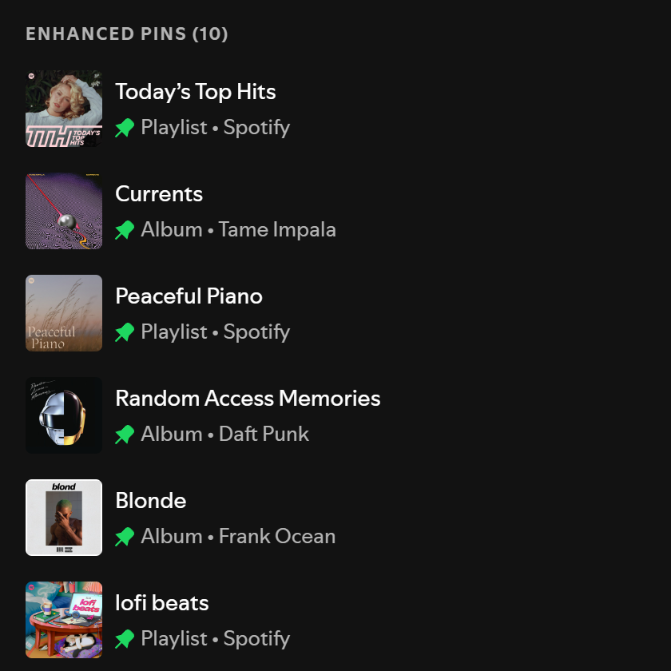

# Enhanced Pins

<!-- site:skip-start -->
**Documentation:** https://spicetify.yusufaf.dev/enhanced-pins/
<!-- site:skip-end -->

Pin as many playlists, albums, podcasts and audiobooks as you want, in their own section at the top of Spotify's sidebar.

Spotify's own pins top out at 20 (up from 4 since July 2026), and they sit inside the library list. Enhanced Pins has no cap, can keep pinned items out of the library list, and adds sorting, icons, shortcuts and backup.



## Features

- **Unlimited Pins**: Pin as many playlists, albums, podcasts, and audiobooks as you want
- **Sorting**: Keep your own order (drag and drop, or Move to top/bottom), or sort alphabetically, by type, or by most recently pinned
- **Show More / Show Less**: Set a maximum number of visible pins and expand the rest on demand
- **Library Deduplication**: Hides pinned items from the native library list so nothing shows up twice
- **Pin Icons**: Mark pins with a preset icon or any emoji, for all pins or per pin
- **Full Context Menu**: Right-click any enhanced pin for Play, Shuffle, Add to Queue, Start a Jam, Go to Radio, Edit, Delete, Download, and more
- **Smart Ownership Detection**: Edit/Delete/Visibility options only appear for playlists you own
- **Backup and Restore**: Export your pins and settings to JSON, and import them on another computer
- **Keyboard Shortcuts**: Optional, rebindable shortcuts to expand the list, open settings, or jump to the first pin; arrow keys and Enter/Space work inside the list
- **Native Integration**: Follows your library's list, compact or grid view and matches Spotify's sidebar look, including artwork, subtitles, and active-item highlighting
- **Theme-Agnostic**: Adapts to any Spicetify theme via CSS variables
- **Lightweight**: Single file, no dependencies, no build step

## How It Works

Enhanced Pins stores pin data in `localStorage` and renders a custom section at the top of the left sidebar. Items are pinned via the right-click context menu on any playlist, album, podcast, or audiobook in Spotify. The extension uses Spicetify Platform APIs (`PlayerAPI`, `PlaylistAPI`, `RootlistAPI`, `LibraryAPI`, etc.) to provide full playback and management controls.

## Installation

Requires [Spicetify](https://spicetify.app/docs/getting-started), installed and applied at least once. The Marketplace route also needs the [Spicetify Marketplace](https://spicetify.app/docs/customization/marketplace) custom app.

### From Spicetify Marketplace

1. In Spotify, open **Marketplace** (the shopping-cart icon at the top left) and stay on the **Extensions** tab.
2. Search for `Enhanced Pins`. If it doesn't show up, click **Load more** (» at the bottom of the list) until it does. Marketplace loads extensions in batches and only searches the ones it has loaded.
3. Hover the **Enhanced Pins** card, click its download button, then click **Reload now**.

### Manually

1. Download [`enhanced-pins.js`](https://raw.githubusercontent.com/yusufaf/spicetify-enhanced-pins/main/enhanced-pins.js) (right-click → **Save link as…**) into your Spicetify `Extensions` folder:
   - Windows: `%APPDATA%\spicetify\Extensions`
   - macOS / Linux: `~/.config/spicetify/Extensions`
2. Enable it and apply:

   ```bash
   spicetify config extensions enhanced-pins.js
   spicetify apply
   ```

The **Enhanced Pins** section appears at the top of the left sidebar.

## Usage

1. **Pin an item**: Right-click any playlist, album, podcast, or audiobook in Spotify's library and select "Enhanced Pin"
2. **Navigate**: Click a pin to open it, double-click to start playback
3. **Reorder**: Drag and drop pins to rearrange
4. **Context menu**: Right-click an enhanced pin for full playback/management options
5. **Unpin**: Right-click an enhanced pin and select "Enhanced Unpin"

### Context Menu Actions

| Action | Description |
|--------|-------------|
| Play / Pause | Toggle playback |
| Shuffle Play | Start shuffled playback |
| Add to Queue | Queue all tracks |
| Start a Jam | Start a Spotify Jam session |
| Go to Radio | Open radio based on the item |
| Edit details | Edit playlist name/description (owned playlists) |
| Delete | Delete playlist (owned playlists) |
| Download | Toggle offline download |
| Make private/public | Toggle playlist visibility (owned playlists) |
| Pin playlist | Add to Spotify's native pins |
| Move to top / Move to bottom | Reorder (Custom sort only) |
| Change icon | Set this pin's icon |
| Enhanced Unpin | Remove from enhanced pins |
| Copy Link | Copy shareable URL |
| Copy Spotify URI | Copy internal URI |

## Settings

Click the gear icon in the Enhanced Pins section header, or choose **Enhanced Pins** in Spotify's profile menu (useful when the library sidebar is hidden).

- **Hide pinned items from library list**: Avoids duplicates in the native library list (default: on)
- **Confirm before unpinning**: Ask before removing a pin (default: off)
- **Sort by**: Custom (manual), Alphabetical, Type, or Recently pinned (default: Custom)
- **Max visible pins**: Show this many pins and collapse the rest behind "Show more" (default: 0, which shows all)
- **Title**: Show or hide the section title, and change its text, font size and color
- **Pin Icon**: The default icon for pins without their own
- **Keyboard shortcuts**: Off by default; each binding can be recorded or cleared
- **Data**: Export pins and settings to JSON, or import them from a file

Pins and settings are stored in Spotify's local storage on this computer, so they don't sync to other devices. Use Export and Import to move them.

## Troubleshooting

**Extension not appearing:**
- Installed from Marketplace: it won't be in your Extensions folder or in `spicetify config extensions`, because Marketplace loads it itself. Check that it's listed on Marketplace's **Installed** tab, then restart Spotify.
- Installed manually: verify `enhanced-pins.js` is in your Spicetify Extensions directory, check that `spicetify config extensions` lists it, and run `spicetify apply` again.

**Console errors:**
- Open DevTools: `Ctrl+Shift+J` (Windows) / `Cmd+Option+J` (macOS)
- Look for `Enhanced Pins:` prefixed console messages

## Contributing

Contributions welcome! See [CONTRIBUTING.md](CONTRIBUTING.md) for details.

## License

MIT License - see [LICENSE](LICENSE) for details.

## Acknowledgments

- Built for [Spicetify](https://spicetify.app/)
